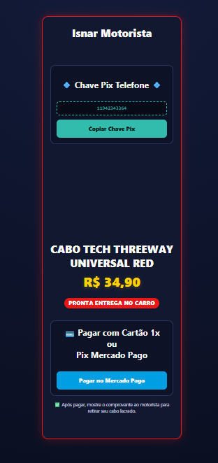

# ⚡ CABO TECH THREEWAY UNIVERSAL RED

Página de vendas oficial do **Cabo Tech Threeway Universal Red**, desenvolvida para divulgação rápida e prática através de QR Code em veículos (Uber), permitindo que passageiros comprem o produto de forma imediata pelo celular.

---

## 📱 Demonstração do Projeto

---

## 🚀 Tecnologias Utilizadas

Este projeto foi construído de forma enxuta, focando em performance, carregamento instantâneo e facilidade de manutenção:

* **HTML5** — Estruturação semântica da página.
* **CSS3** — Estilização moderna, responsiva, com design dark mode e foco em conversão mobile.
* **GitHub Pages** — Hospedagem rápida, gratuita e segura.
* **Mercado Pago** — Integração de pagamentos via link direto (Pix e Cartão de Crédito).

---

## 💡 Sobre o Projeto

O projeto nasceu com o objetivo de criar uma experiência de compra sem atritos (*frictionless*):
1. **Visual Atrativo:** Design escuro alinhado com a identidade visual do produto (LED vermelho).
2. **Foco Mobile:** Totalmente responsivo para telas de smartphones, já que o acesso é feito via QR Code no encosto do banco.
3. **Checkout Seguro:** Redirecionamento direto para o ambiente seguro do Mercado Pago.

---

## 🌐 Acesse a Página

Você pode acessar a página em funcionamento através do link:  
👉 **[https://isnarsantanna.github.io/Produtos/](https://isnarsantanna.github.io/Produtos/)**

---

## 📄 Licença

Este projeto é de uso pessoal e comercial por **Isnar Santanna**. Todos os direitos reservados.
